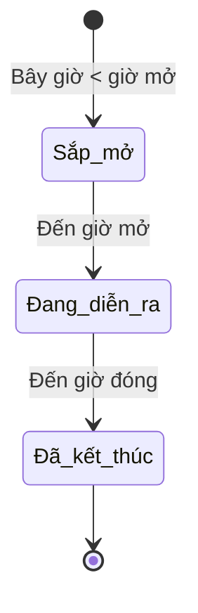

# Workflow vận hành đấu giá đồng hồ

Workflow này dùng cho plugin `Luxury Watches Auctions` và trang `/dau-gia/`.

## 1. Chuẩn bị sản phẩm

1. Tạo sản phẩm WooCommerce với SKU duy nhất.
2. Gắn ảnh đại diện rõ mặt số, tên sản phẩm, mô tả và danh mục Nam/Nữ.
3. Đặt tồn kho là `1` và bật chế độ bán riêng lẻ.
4. Không công bố phiên nếu ảnh, giá niêm yết hoặc SKU còn thiếu.

## 2. Tạo phiên đấu giá

Trang quản trị riêng tại `/quan-tri-dau-gia/` dùng chung tài khoản WordPress. Người chưa đăng nhập được chuyển tới trang đăng nhập; tài khoản cần quyền quản lý WooCommerce và chỉnh sửa nội dung để vào trang. Nút **Tạo phiên mới** mở biểu mẫu chọn sản phẩm theo tên/SKU, tên phiên, mã phiên, mô tả, ảnh đại diện riêng, các mức giá và lịch mở/đóng. Múi giờ được hiển thị trong biểu mẫu.

Biểu mẫu dùng ảnh sản phẩm nếu bỏ trống ảnh riêng. **Lưu nháp** lưu phiên chưa công bố. **Đăng phiên đấu giá** yêu cầu ảnh hợp lệ, giờ kết thúc ở tương lai và quyền xuất bản. Khi báo lỗi, các trường nhập được giữ lại và file ảnh cần được chọn lại. Mã phiên trùng bị từ chối. Gửi lại cùng biểu mẫu sau khi đã lưu thành công dùng lại phiên đã tạo. Danh sách phân trang hiển thị trạng thái, giá khởi điểm và lịch kết thúc. Liên kết **Chỉnh sửa** mở trình sửa phiên hiện có trong WordPress.

Mỗi phiên phải có sản phẩm liên kết, mã phiên duy nhất, giá niêm yết, giá khởi điểm, bước giá, giá dự trữ, ảnh đại diện và khoảng thời gian hợp lệ.

Script `php scripts/add_auction_collection.php` tạo hoặc cập nhật bộ năm phiên mẫu. Script dùng SKU và slug nên có thể chạy lại mà không sinh bản ghi trùng.

Trong WordPress, mở **Đấu giá → Chỉnh sửa phiên → Thiết lập phiên đấu giá** để cấu hình sản phẩm, giá và thời gian. Máy chủ kiểm tra sản phẩm WooCommerce tồn tại, giá khởi điểm và bước giá lớn hơn 0, ngày giờ hợp lệ và giờ kết thúc sau giờ bắt đầu. Khi thiết lập sai, các trường cấu hình giữ giá trị đã lưu và trang quản trị hiển thị thông báo lỗi.

Sau khi có lượt trả giá hoặc đã xác nhận kết quả, thao tác lưu trong trang quản trị khóa sản phẩm liên kết, giá khởi điểm, bước giá, giá dự trữ và thời gian mở/đóng. Script dữ liệu mẫu dành cho môi trường thử nghiệm và có thể ghi đè các thiết lập này, nên cần kiểm tra dữ liệu trước khi chạy lại.

## 3. Vòng đời phiên



Trạng thái được tính trên máy chủ theo múi giờ WordPress. Giao diện chỉ hiển thị bộ đếm; quyền nhận giá luôn do máy chủ quyết định.

## 4. Luồng trả giá an toàn

1. Thành viên đăng nhập và gửi giá kèm nonce.
2. Máy chủ kiểm tra phiên tồn tại, đã công bố và đang mở.
3. Hệ thống chặn gửi lặp trong ba giây.
4. Transaction khóa bản ghi phiên để tuần tự hóa các lượt gửi đồng thời.
5. Máy chủ đọc lại giá cao nhất, tính giá tối thiểu và xác nhận đúng bước giá.
6. Chỉ lượt hợp lệ được ghi vào bảng `wp_luxury_auction_bids`; sau đó transaction mới commit.
7. Người dùng được chuyển về trang phiên với thông báo thành công hoặc hướng khắc phục cụ thể.

## 5. Checklist trước khi công bố

- Chạy PHP lint cho plugin và script dữ liệu.
- Mở `/dau-gia/` và ít nhất một trang chi tiết, xác nhận HTTP 200.
- Kiểm tra bộ lọc Đang diễn ra, Sắp mở và Đã kết thúc.
- Kiểm tra desktop và mobile, đặc biệt giá tiền, ảnh và nút trả giá.
- Đăng nhập bằng tài khoản thử nghiệm, gửi một giá đúng và một giá sai bước.
- Xác nhận giá sai không được ghi; xóa dữ liệu thử nghiệm sau kiểm tra.
- Sao lưu cơ sở dữ liệu trước khi thay đổi hàng loạt phiên đang hoạt động.

## 6. Xử lý sự cố

- **Không kết nối cơ sở dữ liệu:** khởi động MySQL trong XAMPP trước khi chạy script.
- **Ảnh không hiện:** kiểm tra file trong `wordpress/wp-content/uploads/2026/10/luxury-auctions/` và attachment ID.
- **Giá bị từ chối:** tải lại trang để nhận giá tối thiểu mới nhất; không sửa trực tiếp bảng bid.
- **Phiên không đổi trạng thái:** kiểm tra múi giờ WordPress và định dạng `Y-m-dTH:i` của thời gian mở/đóng.
- **Gửi trùng:** giữ nguyên khóa transaction và rate limit; không bỏ kiểm tra lại trạng thái trong transaction.

## 7. Xác nhận người thắng

1. Người có quyền quản lý WooCommerce và sửa phiên mở phiên trong trang quản trị WordPress.
2. Xem khung **Kết quả và lịch sử trả giá**, gồm giá dự trữ và 20 lượt trả gần nhất.
3. Khi phiên đã kết thúc và có lượt trả đạt giá dự trữ, bấm **Xác nhận người thắng**. Thao tác dùng cấu hình đã lưu, vì vậy cần lưu chỉnh sửa trước khi xác nhận.
4. Máy chủ khóa phiên và kiểm tra lại thời gian, giá dự trữ và lượt trả cao nhất. Nếu các lượt có cùng giá trong dữ liệu cũ, lượt được ghi trước có ưu tiên.
5. Kết quả lưu ID lượt trả, tài khoản người thắng, số tiền, người xác nhận và thời điểm xác nhận trong metadata `_lw_auction_result` của phiên. Xác nhận lại dùng kết quả đã lưu.
6. Quản trị viên dùng email hiển thị trong khung kết quả để liên hệ thanh toán.

Phiên chưa có lượt trả hoặc chưa đạt giá dự trữ cần quản trị viên xem xét. Việc xác nhận kết quả kết thúc ở bước ghi nhận người thắng và thông tin liên hệ thanh toán.

## 8. Kiểm tra backend

Chạy từ thư mục gốc với PHP của môi trường đang cài WordPress.

```powershell
php scripts/tests/auction_validation.php
php scripts/tests/auction_bidding.php
php scripts/tests/auction_confirmation.php
php scripts/tests/auction_dashboard.php
```

Các kiểm tra dùng dữ liệu tạm và dọn lại sau khi chạy. Kiểm tra lượt trả giá và xác nhận kết quả tạo tài khoản, sản phẩm hoặc phiên tạm trong database đang kết nối, nên chạy trên môi trường phát triển. Kiểm tra thời gian, số tiền, lưu cấu hình, khóa quy tắc sau lượt trả, phân quyền và xác nhận lặp được thực hiện qua mã backend thật.
